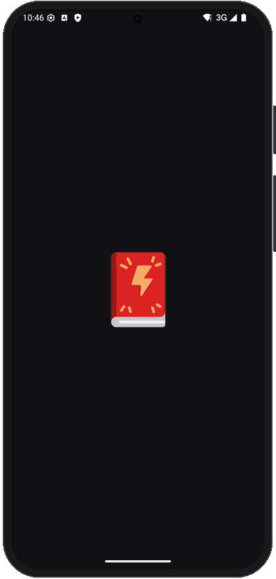

  

    <h2>MangaD</h2>
    
Простая читалка манги для Android.

    
    

  <a href="README.md">English</a> • <strong>Русский</strong>

---

MangaD помогает находить мангу, манхву и маньхуа, читать их и не терять,
где вы остановились. Без аккаунта и регистрации.

### Что умеет приложение

- **Поиск чтения**: последние обновления, поиск по названию и фильтр по
  жанрам.
- **Чтение как вам удобно**: вебтун-прокрутка, постраничное чтение (слева
  направо или справа налево) или вертикальные страницы, с настройкой
  масштаба, яркости и ориентации.
- **Библиотека**: сохраняйте тайтлы, которые читаете, и узнавайте о новых
  главах.
- **Продолжить с того же места**: история чтения помнит последнюю главу в
  каждом тайтле.
- **Светлая и тёмная темы**: или как в системе.
- **Уведомления о новых главах**: библиотека проверяется каждые 12 часов,
  или проверьте вручную в любой момент.
- **Сохранение в EPUB**: скачивайте тайтлы целиком как EPUB-книги и читайте
  офлайн в любой читалке.
- **Отслеживание в AniList**: свяжите тайтл, и прогресс, статус, оценка и
  даты синхронизируются по мере чтения. Главы, прочитанные в другом месте,
  отмечаются прочитанными и здесь.
- **Уведомления об обновлениях**: на главном экране видно, когда вышла
  новая версия.

### Скоро

- Резервная копия библиотеки и истории
- Синхронизация с MyAnimeList
- Категории библиотеки
- Главы офлайн в приложении
- Больше источников
- Статистика чтения

Есть идея? Расскажите в [Discord](https://discord.gg/6CQ6u64dca).

### Другие наши приложения

[Ranobe](https://github.com/ranobe-org/ranobe)
— читалка ранобэ.

### Отказ от ответственности

MangaD не связано с контентом, который показывается в приложении. Оно
получает его из источников, свободно доступных в любом браузере.
